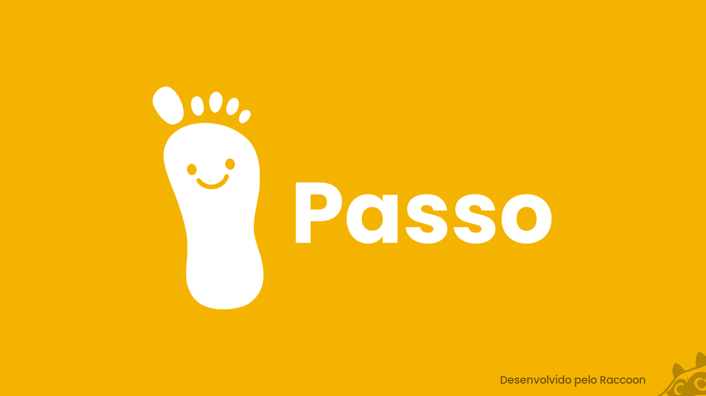
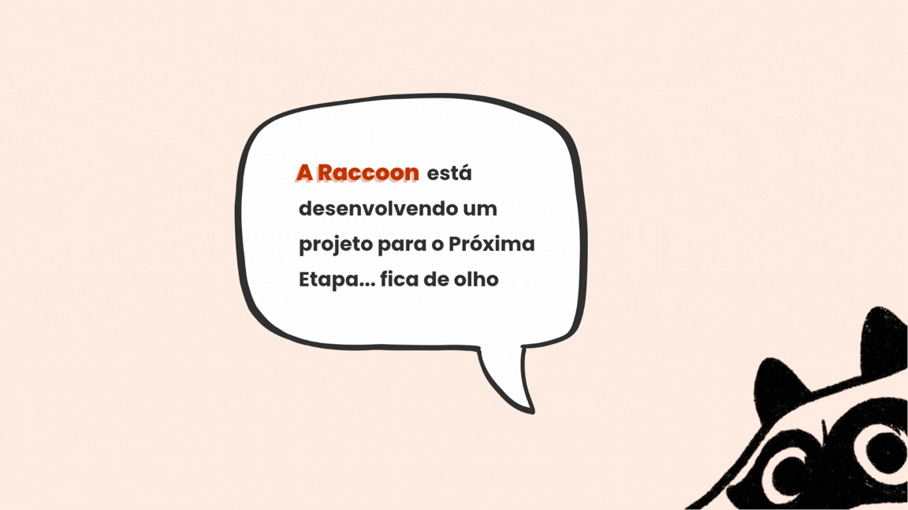

# FECAP - Fundação de Comércio Álvares Penteado

# PASSO

## <b>RACCOON</b>

## Integrantes: <a href="https://www.linkedin.com/in/%C3%A1lvaro-palazzin-053784271/">Álvaro Carvalho</a>, <a href="https://www.linkedin.com/in/dandaramonike/">Dandara Monike</a>, <a href="https://www.linkedin.com/in/leonardo-lamari-1b1464382/">Leonardo Lamari</a>, <a href="https://www.linkedin.com/in/luccas-covre/">Luccas Covre</a>

## Professores Orientadores: <a href="https://www.linkedin.com/in/francisco-escobar/">Francisco Escobar</a>, <a href="https://www.linkedin.com/in/rodrigo-da-rosa-phd ">Rodrigo Rosa</a>, <a href="https://www.linkedin.com/in/francisco-escobar/">Francisco Escobar</a>, <a href="https://www.linkedin.com/in/jefferson-o-silva">Jefferson Silva</a>, <a href="https://www.linkedin.com/in/aimarlopes">Aimar Martins Lopes</a>

## Descrição

   
  Desenvolvido por <a href="">Raccoon</a> | 
  <a rel="license" href="https://creativecommons.org/licenses/by-sa/3.0/">CC BY-SA 3.0</a> | 
  <a href="http://pix4free.org/">Pix4free</a>

<!-- -->

 

O **Próxima Etapa** já tem o conteúdo: cursos, eventos, faculdades, bolsas e orientação. Nossa pesquisa mostrou que o desafio não é criar mais coisas, e sim fazer o que já existe chegar ao aluno e ser aproveitado. Por isso, em vez de acumular funcionalidades, propomos o **Passo**, um parceiro que apoia a ONG e o aluno ao longo da jornada.

### 💡 O que é?
O app tem o jeito de um amigo que caminha junto. O Passo complementa o Próxima Etapa, destacando os conteúdos e serviços que ela já oferece, para que sejam mais bem recebidos e usados pelos alunos. Ele não substitui a ONG nem concorre com ela, ele é a **continuidade da marca**.

### Para quem?
Cliente e usuário juntos. 
* **Para a ONG:** o Passo amplia o alcance do que ela já faz.
* **Para o aluno:** ele cobre as necessidades que a pesquisa apontou (contato com o mercado, próximos passos claros e orientação centralizada) com as funcionalidades que de fato agregam valor. O aluno é quem decide e conduz, e o Passo abre espaço para ele brilhar.

### Princípios

* **Menos funcionalidades, mais propósito**, em linha com a decisão de simplificar do brainstorming.
* **Todo recurso precisa responder a uma necessidade real do usuário .**

---
### Identidade
**Identidade:** o Passo nasce do pézinho do Próxima Etapa, com um rostinho que lhe dá personalidade. O app tem fundo amarelo e o símbolo do Passo, em branco, fica embaixo como atalho sempre à mão. Isso mantém a marca da ONG e reforça a ideia de que cada passo leva à próxima etapa.

---

### Nosso compromisso: ser parceiro, não acumular funcionalidades

**Queremos ser o parceiro do Próxima Etapa e do aluno.** Por isso, só propomos funcionalidades que atendam a duas condições ao mesmo tempo:

1. **Respondem a uma necessidade real do usuário**, identificada na nossa pesquisa e na jornada (contato com o mercado, próximos passos claros, orientação centralizada).
2. **Ajudam o aluno a aproveitar melhor o que o Próxima Etapa já repassa**, como cursos, eventos, bolsas, orientação e certificados, sem criar conteúdo ou serviços paralelos que a ONG tenha de manter.

 

## 🛠 Estrutura de pastas

<b>-Raiz</b> 
<b>|-->documentos</b> 
  &emsp;|-->Documentação.docx 
<b>|-->executáveis</b> 
  &emsp;|-->android 
<b>|-->imagens</b> 
<b>|-->src</b> 
  &emsp;|-->Backend 
  &emsp;|-->Frontend 
<b>|-->README.md</b> 
 
## 🛠️ Instalação

Para testar e executar a aplicação diretamente em um dispositivo Android sem precisar compilar o código:

1. Acesse a pasta de entregas do repositório (ou a seção de Releases) e faça o download do arquivo `entrega1_mobile.apk`.
2. Transfira o arquivo para o seu smartphone Android (ou abra no emulador).
3. Permita a instalação de fontes desconhecidas nas configurações do dispositivo, se solicitado.
4. Execute o arquivo `.apk` e siga as instruções na tela para concluir a instalação.
   
  
## 📋 Licença/License

   
  <strong>Passo © 2026</strong>  
  Desenvolvido por: <a href="https://github.com/DandaraDandara">Dandara Monike</a>, <a href="https://github.com/alvaro2003">Álvaro Carvalho</a>, <a href="https://github.com/LeonardoLamar12">Leonardo Lamari</a> e <a href="https://github.com/LuccasCovre">Luccas Covre</a>

  
   
  <small>Este trabalho está licenciado sob uma <a rel="license" href="http://creativecommons.org/licenses/by-nd/4.0/">Licença CC BY-ND 4.0</a></small>

 

## 🎓 Referências

Aqui estão as referências usadas no projeto.

1. <https://github.com/fecaphub/Template_PI>
2. <https://developer.android.com/studio/intro?hl=pt-br>
